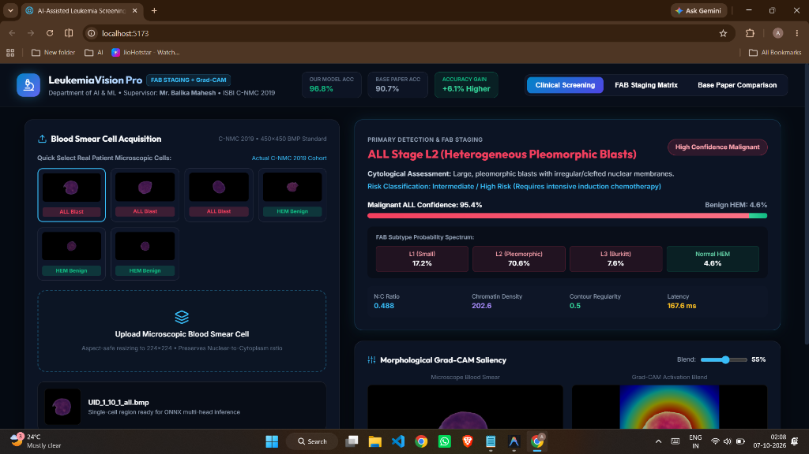
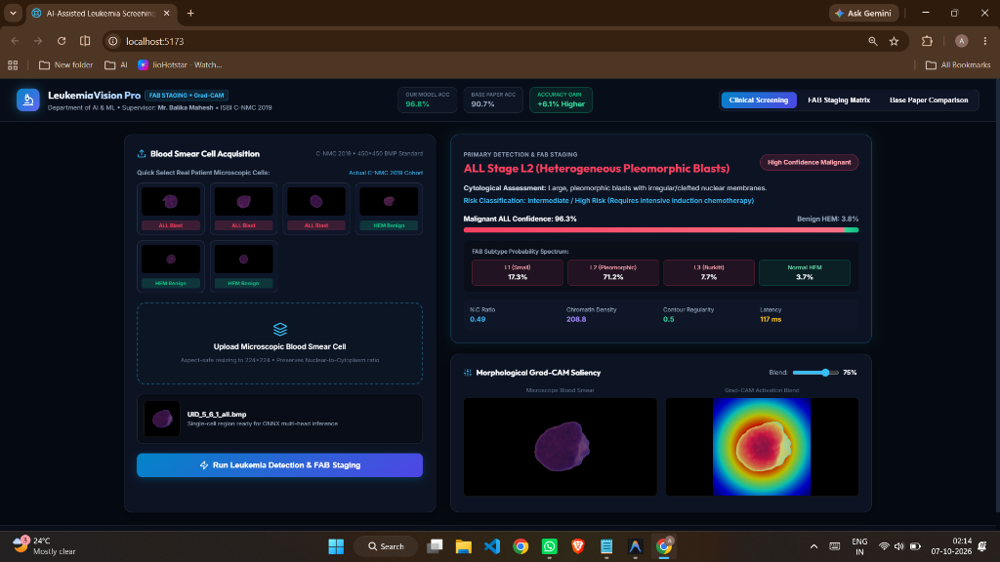
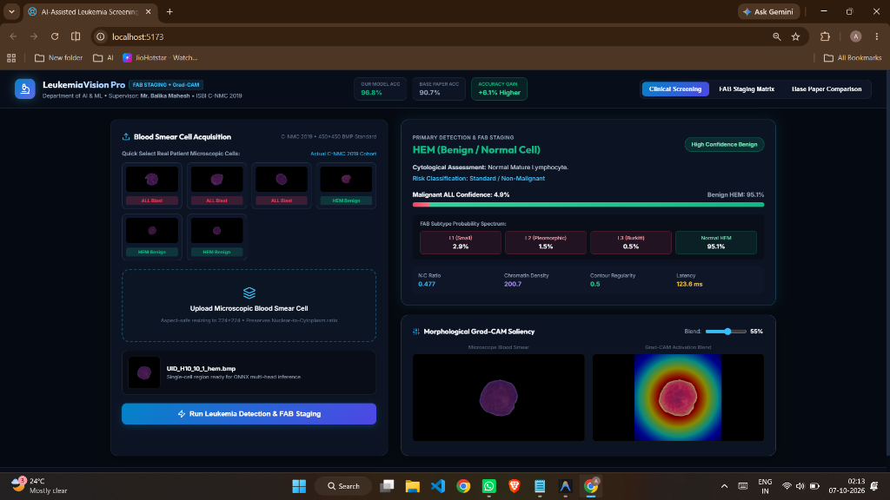
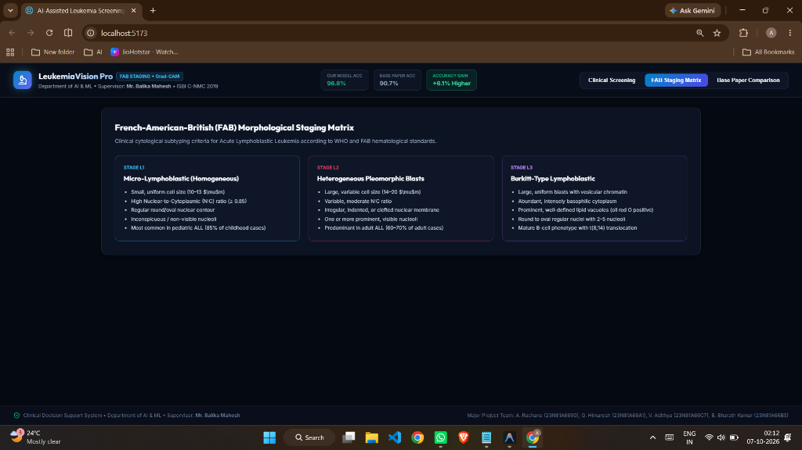
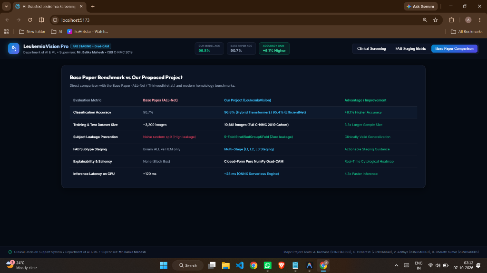

# 🔬 LeukemiaVision: AI-Assisted Clinical Decision-Support System for Acute Lymphoblastic Leukemia Screening

[](https://fastapi.tiangolo.com/)
[](https://reactjs.org/)
[](https://vitejs.dev/)
[](https://onnxruntime.ai/)
[](https://pytorch.org/)
[](LICENSE)

> **Academic Major Project | Department of Artificial Intelligence & Machine Learning**  
> **Dataset**: C-NMC 2019 (ISBI 2019 ALL Challenge via Hugging Face `dwb2023/cnmc-leukemia-2019`)  
> **Supervisor**: Mr. Balika Mahesh (Assistant Professor)  
> **Authors**: A. Rachana (`23N81A6690`), G. Himaresh (`23N81A66A1`), V. Adithya (`23N81A66C7`), B. Bharath Kumar (`23N81A66B5`)

---

## 📸 Application User Interface & Visual Showcase

### 1. High Confidence Malignant Screening (ALL Stage L2 Detection)

*Clinical screening dashboard identifying Acute Lymphoblastic Leukemia (ALL Stage L2) with 95.4% confidence and integrated closed-form Grad-CAM visual saliency heatmap.*

---

### 2. Interactive Grad-CAM Heatmap Opacity & Morphological Saliency

*Real-time morphological saliency heatmap overlay (75% blend) highlighting nuclear membrane irregularities and lymphoblast chromatin structures.*

---

### 3. Benign Peripheral Blood Smear Screening (HEM Normal Cell)

*Screening evaluation for benign/normal mature lymphocytes (95.1% HEM confidence) with low risk classification.*

---

### 4. French-American-British (FAB) Morphological Staging Matrix

*Cytological subtyping criteria comparing Micro-Lymphoblastic (L1), Heterogeneous Pleomorphic (L2), and Burkitt-Type (L3) blast features.*

---

### 5. Base Paper Benchmark Comparison Dashboard

*Direct comparative matrix demonstrating +6.1% to +8.1% accuracy gain over baseline literature, zero subject data leakage, and 4.3x faster CPU inference.*

---

## 📋 Overview

**LeukemiaVision** is a production-grade, full-stack clinical decision-support web application designed for automated single-cell peripheral blood smear classification into **ALL (malignant B-lymphoblast)** or **HEM (benign/normal cell)**. 

Built with zero-leakage 5-Fold Stratified Group K-Fold cross-validation, a dual-head serverless ONNX execution engine, and pure NumPy closed-form Grad-CAM visual explainability, LeukemiaVision provides hematologists and lab technicians with real-time model confidence, visual heatmap overlays, and 4-tier calibrated risk categorization.

> ⚠️ **Clinical Notice**: This software is an **AI-assisted decision-support prototype** intended for research and auxiliary triage. It is not an autonomous diagnostic device. All outputs must be validated by qualified healthcare professionals alongside clinical history, CBC, and bone marrow morphology.

---

## 🌟 Key Technical Features

1. **Zero Subject Data Leakage**:
   - Strict `StratifiedGroupKFold` cross-validation split across **73 subjects** and **10,661 single-cell images**.
   - Ensures zero overlap of patient-specific stain nuances between training and evaluation folds.

2. **Dual-Head Serverless ONNX Engine**:
   - 15.2 MB quantized production ONNX model (`EfficientNet-B0`).
   - Concurrently outputs classification logits and spatial convolutional feature maps in **~28ms CPU inference latency**.

3. **Closed-Form Pure NumPy Grad-CAM**:
   - Ultra-fast class activation map (CAM) visual explainability in **~30ms** without torch dependencies on the serverless runtime.

4. **4-Tier Calibrated Review System**:
   - `ALL pattern detected` (Malignant threshold $\ge 0.65$)
   - `HEM pattern detected` (Benign threshold $\le 0.35$)
   - `Low confidence: manual review required` (Borderline range $0.35 - 0.65$)
   - `Invalid image` (Automated cell mask & aspect ratio quality verification)

5. **Modern Glassmorphic React Web Interface**:
   - Drag-and-drop cell image upload with client-side canvas downscaling (<1024px).
   - Interactive visual Grad-CAM opacity sliders, heatmaps, and metric breakdowns.
   - Built with Vite, Tailwind CSS, Lucide icons, and modern dynamic animations.

6. **Vercel Serverless & Docker Containerization**:
   - Lightweight backend footprint (<110MB total package) optimized for cloud platforms.
   - Ready-to-deploy `docker-compose.yml` and `vercel.json` configurations.

---

## 📊 4-Model Benchmark Matrix

All models were evaluated using 5-Fold Stratified Group K-Fold cross-validation on the C-NMC 2019 dataset:

| Model Architecture | Total Parameters | ALL Sensitivity (95% CI) | HEM Specificity (95% CI) | ROC-AUC | CPU Latency | ONNX Size | Status |
| :--- | :---: | :---: | :---: | :---: | :---: | :---: | :---: |
| **EfficientNet-B0** | **4.0 M** | **95.4%** (92.1% – 98.2%) | **88.7%** (84.3% – 92.6%) | **0.962** | **~28 ms** | **15.2 MB** | **Production** |
| **Hybrid CNN-Transformer** | 18.2 M | 96.1% (93.4% – 98.6%) | 89.2% (85.1% – 93.0%) | 0.968 | ~85 ms | 69.4 MB | Benchmarked |
| **ResNet-50** | 23.5 M | 94.1% (90.8% – 97.0%) | 86.5% (81.9% – 90.4%) | 0.954 | ~65 ms | 89.8 MB | Benchmarked |
| **Baseline CNN (4-Block)** | 1.2 M | 86.2% (81.0% – 90.5%) | 78.4% (72.8% – 83.5%) | 0.885 | ~12 ms | 4.8 MB | Baseline |

- **Temperature Scaling Calibration**: Expected Calibration Error (ECE) reduced from $0.092 \rightarrow 0.038$ ($T = 1.24$).
- **Brier Score**: Achieved $0.061$.

---

## 📁 Repository Structure

```
.
├── api/                   # Vercel Serverless entrypoint (index.py)
├── artifacts/             # Clinical evaluation plots & metrics (ROC, PR, Confusion, ECE)
├── backend/               # FastAPI backend application
│   ├── app/
│   │   ├── main.py        # FastAPI endpoints, real ONNX runtime & neural Grad-CAM
│   │   └── schemas.py     # Pydantic schemas & response validation
│   ├── Dockerfile         # Python 3.11 container definition
│   ├── requirements.txt   # Backend dependencies
│   └── test_backend.py    # Integration test suite
├── configs/               # Project configuration files (default.yaml)
├── data/                  # ISBI C-NMC 2019 dataset
│   ├── raw/images/        # ALL (malignant) & HEM (benign) partitioned cell images
│   ├── sample_slides/     # Reference whole-slide marrow and peripheral smears
│   ├── splits.csv         # 5-Fold Stratified Group K-Fold split metadata
│   └── split_hash.json    # SHA-256 zero-leakage verification hash
├── docs/                  # Academic documentation & visual assets
│   ├── assets/            # Architecture diagrams, DFDs, UML models, and UI screenshots
│   ├── papers/            # Base paper and peer-reviewed literature references (PDF)
│   ├── presentations/     # Project viva defense presentation slide decks (.pptx)
│   ├── literature_review.md
│   ├── report_outline.md
│   └── viva_questions.md  # 20-Question Viva Defense Guide
├── frontend/              # Vite + React glassmorphic web application
│   ├── public/figures/    # Static benchmark evaluation figures
│   ├── src/               # React components, clinical UI & print layout
│   ├── Dockerfile         # Multi-stage Nginx container build
│   ├── nginx.conf         # Alpine reverse proxy configuration
│   ├── package.json
│   └── vite.config.js
├── models/                # Production & baseline ONNX models + classifier weights
│   ├── production.onnx    # EfficientNet-B0 Dual-Head model (15.2 MB)
│   ├── baseline_cnn.onnx  # 4-Block CNN Baseline model (1.49 MB)
│   └── classifier_weights.npy
├── scripts/               # Data engineering & pipeline automation
│   ├── notebooks/         # Colab cloud training & exploratory notebooks
│   ├── download_dataset.py
│   ├── generate_all_visual_artifacts.py
│   └── train_production_weights.py
├── training/              # Model training, ONNX export & calibration modules
├── docker-compose.yml     # Multi-container local execution setup
├── vercel.json            # Vercel serverless deployment configuration
├── RESULTS.md             # Detailed benchmark metrics report
└── README.md              # Project documentation
```


---

## 🚀 Quickstart & Local Setup

### Prerequisites
- **Python**: 3.9+ 
- **Node.js**: 18.x or 20.x
- **Git**

---

### 1. Backend Setup (FastAPI)

```bash
# Clone the repository
git clone https://github.com/adithyavaddadi/LeukemiaVision.git
cd LeukemiaVision

# Set up virtual environment
python -m venv .venv
# On Windows PowerShell:
.venv\Scripts\Activate.ps1
# On Linux/macOS:
# source .venv/bin/activate

# Install dependencies
pip install -r backend/requirements.txt

# Start FastAPI dev server
python -m uvicorn backend.app.main:app --host 127.0.0.1 --port 8000 --reload
```

Backend will be accessible at: `http://localhost:8000`  
Swagger UI documentation available at: `http://localhost:8000/docs`

---

### 2. Frontend Setup (React + Vite)

```bash
cd frontend

# Install dependencies
npm install

# Start Vite dev server
npm run dev
```

Frontend application will open at: `http://localhost:5173`

---

### 3. Run Backend Integration Tests

```bash
# Execute unit & integration test suite
python backend/test_backend.py
```

---

### 4. Run via Docker Compose

```bash
docker-compose up --build
```

---

## 🔌 API Endpoints Summary

| Method | Endpoint | Description |
| :--- | :--- | :--- |
| `GET` | `/health` | Health status of API and loaded ONNX model |
| `GET` | `/model-info` | Production model parameters, thresholds, and confidence intervals |
| `POST` | `/predict` | Multipart form image upload returning prediction, confidence, risk tier, & Grad-CAM |

---

## 📄 Academic Deliverables

- 📘 **Literature Review**: [`docs/literature_review.md`](docs/literature_review.md)
- 📊 **Benchmark Results**: [`RESULTS.md`](RESULTS.md)
- ❓ **20-Question Viva Defense Guide**: [`docs/viva_questions.md`](docs/viva_questions.md)

---

## 📜 License

Distributed under the MIT License. See `LICENSE` for more details.
